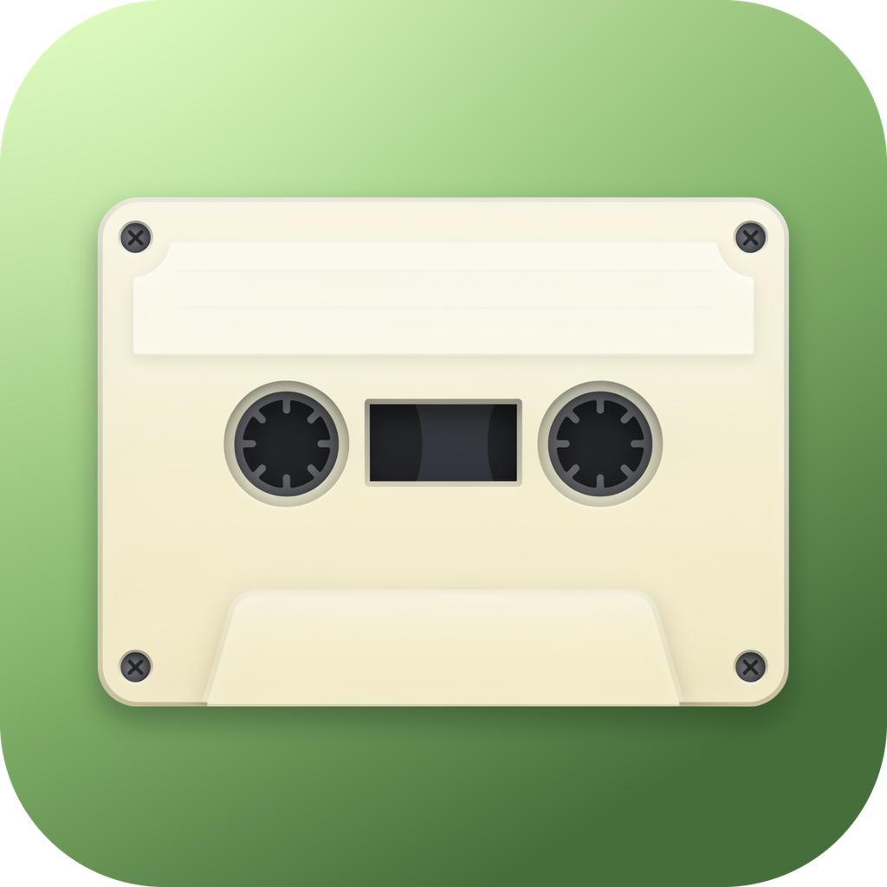

# RetroRIP

A lightweight Windows 11 desktop app for converting YouTube links to **MP3, MP4, AVI, WAV, or FLAC** — wrapped in a native Fluent UI with real Mica/Acrylic materials, so it blends right into Windows 11.

Downloads are powered by [yt-dlp](https://github.com/yt-dlp/yt-dlp) and [ffmpeg](https://ffmpeg.org/), which RetroRIP fetches automatically on first launch.



## Features

- **Convert** — Paste a link, park it in the queue with **+**, then hit **Convert** to download everything at once (a link still in the box is downloaded right away).
- **Downloads** — Live progress for active downloads, a green **Done** badge for finished files, and a red exclamation indicator for failures — hover it to see exactly why a download failed.
- **Queue handoff** — Started downloads show a temporary download indicator in the Queue, then move over to Downloads to keep the list clean.
- **Library** — Browse, preview, open, and delete your downloaded audio and video.
- **Settings** — Separate default Audio/Video folders, Light / Dark / System theme, system or custom accent colors (Red, Pink, Matcha, Purple, Blue, White), and default download quality.
- **Windows 11 native feel** — Mica in light mode, Acrylic in dark mode, collapsible Fluent navigation pane, and a custom title bar with the RetroRIP cassette icon.

## Download (ready to run)

Download `RetroRIP-1.0.0.exe` from the Releases page and double-click it — it's a portable build, no installation required.

> On first launch Windows SmartScreen may warn that the app is unsigned: choose **More info → Run anyway**. RetroRIP will then download yt-dlp and ffmpeg into its app-data folder, so the first start needs an internet connection.

## Run from source

Requirements: Node.js 20+ (npm) and, for packaging, Windows 10/11.

```bash
npm install --legacy-peer-deps

# Develop (Vite dev server + Electron)
npm run electron:dev

# Production frontend build only
npm run build

# Build the portable Windows .EXE (output in ./release)
npm run electron:build
```

Default save locations are your system **Music** and **Videos** folders; both can be changed in Settings.

## Project structure

```
electron/   Main process (window, Mica/Acrylic material, IPC, yt-dlp/ffmpeg runner)
src/        React + Fluent UI renderer (App, themes)
assets/     App icon (icon.png / icon.ico)
```

## Legal

RetroRIP is a tool for downloading media you own or have permission to download. Please respect copyright law and YouTube's Terms of Service. RetroRIP is not affiliated with YouTube or Google.

## Credits

This project was created with AI tools by **Mr Knight** — October 2026.

## Support Development

This application is free to use.

If you enjoy using it and would like to support
future development, voluntary donations are welcome.

Donations are entirely optional and are not required
to download or use this application.
